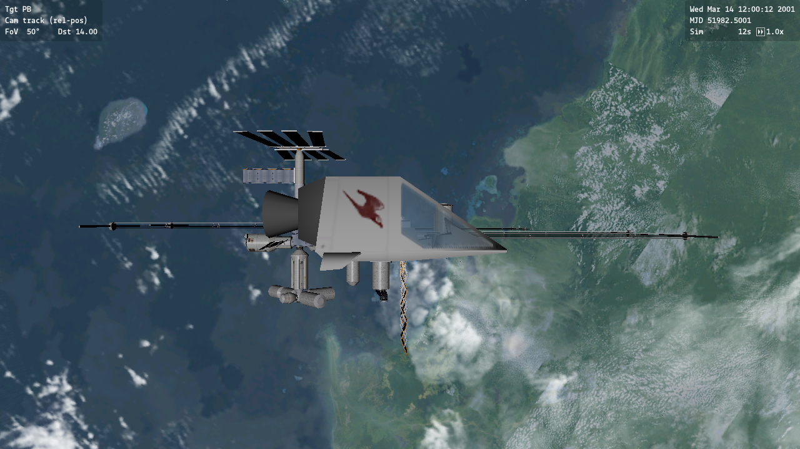

# Accepted real Windows OpenGL client

Accepted [hosted run 41198786277](https://github.com/dcajacob/orbiter-cross-platform/actions/runs/41198786277),
source `21f92f44f3afd0c3ca8a704edd4ef2ce8e10c6a0`. Both MSVC x64 Debug and
Release execute the separately built `OGLClient.dll` inside the production
Windows Orbiter application. The actual objects are Sol, config-driven stock
ISS (`ISS\ProjectAlpha_ISS`) and the source-built ShuttlePB module/mesh.

Each configuration runs two fresh processes: 60 original 0.25-second physics
ticks, with an unmodified full-frame readback at finalized tick 50 (12.5 s).
Numerical/event repeats and image bytes match exactly. All measured state errors
against the frozen Phase 1 production fixture are zero. Hosted Debug/Release
comparison has zero state and projected landmark error, with identical images
(SSIM 1.0). No acceptance budget was widened. Actual mesh/material/texture
counts, vessel draw calls, Earth archive reads and textured tile submissions,
loaded DLL paths/hashes, asset hashes, 60 successful presents and normal visual/
context teardown are recorded.

The application and public SDK source revision is
`06d8989823c59e651061d409425c19ec71360bfa`. Debug reuses its verified retained
runtime. Release was freshly rebuilt from that same source; existing Lua and
collision application tests and the locked dependency audit passed before it
was packaged and used. The renderer's dependencies and notices are pinned
separately. The public Windows SDK and production numerical code are unchanged.



`provenance.json` locks these canonical reference files and original CI artifact
ZIPs, their complete member hashes, source revisions, data profiles and budgets.
The original artifacts, compiled renderer/shaders/notices, complete logs and
representative capture are preserved in [versioned release storage](https://github.com/dcajacob/orbiter-cross-platform/releases/tag/production-windows-client-v2).
The release contains an experimental Windows component and engineering evidence;
installation and the stock-playable native Linux release are later milestones.

```sh
python3 -B Tests/Production/frozen_client.py
python3 -B Tests/Production/frozen_client.py --artifacts /path/to/downloaded-original-ZIPs
```

There is no automatic reference refresh. The prior two-body, production orbit/
propulsion and fourteen behavioral goldens remain unchanged. The canonical
image is a lossless conversion of the original GL readback, without visual edits
or masks. Full source/build/run commands and remaining integration limits are
in [the Windows client notes](../../../Docs/Production/WindowsClient.md).

This gate covers the external stock scene. Cockpit/instrument semantics, all
stock scenarios, native Linux production execution, repeated sessions in one
process and hardware performance remain later acceptance gates.
